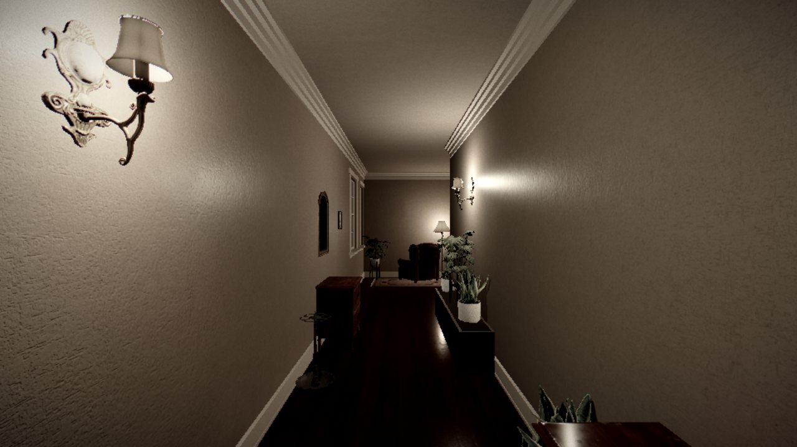
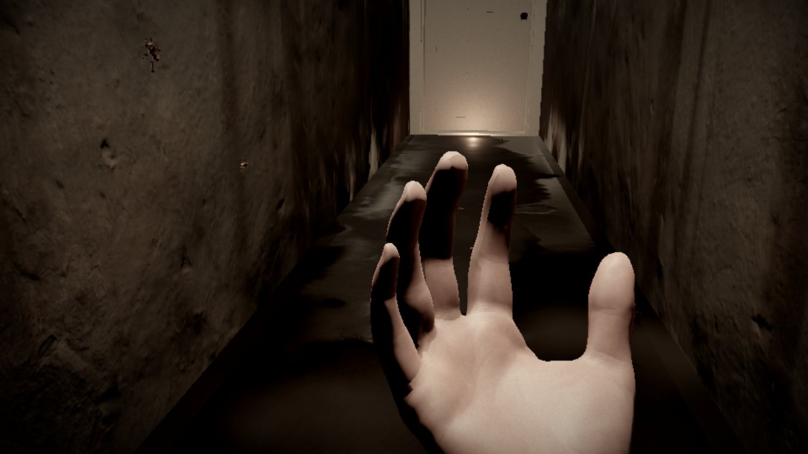
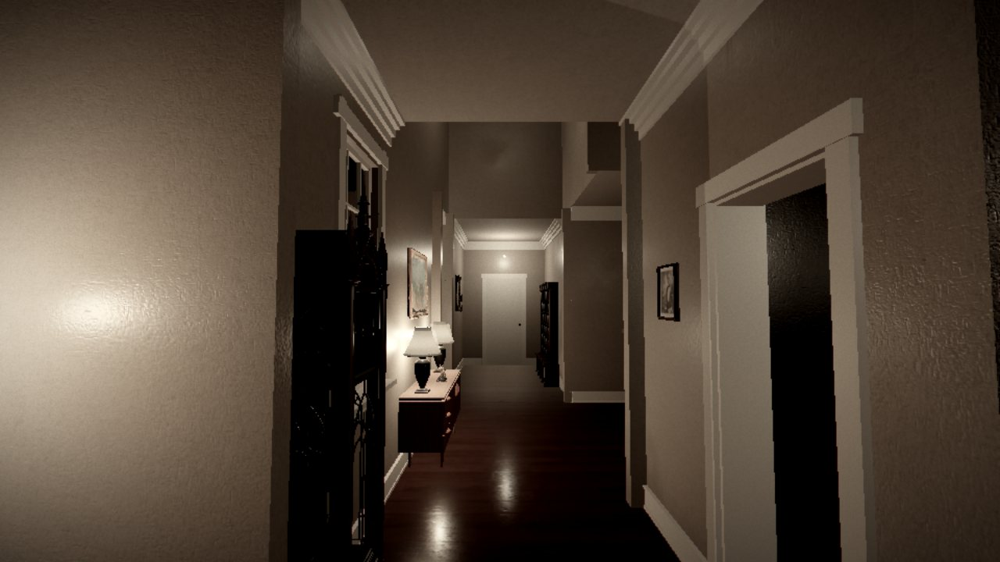
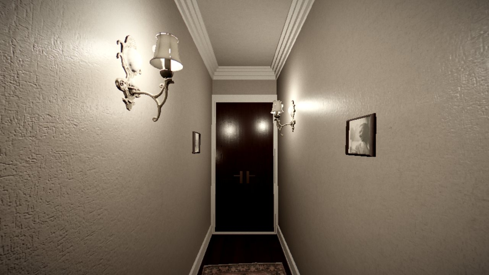
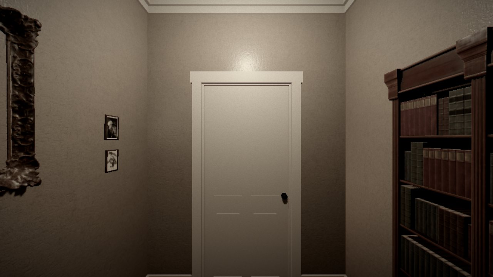

<div align="center">

# LOOP

ブラウザで遊べる一人称ホラーゲーム。

[English](README.md) · [Tiếng Việt](README.vi.md) · **日本語**

[](https://github.com/nhhthong/loop/actions/workflows/ci.yml)
[](LICENSE)

### [▶ プレイ](https://nhhthong.github.io/loop/)



</div>

## 概要

濡れた地下廊下で目を覚ます。扉の先は誰もいない家。薄暗いランプ、軋む天井ファン、開かない扉。
台詞もジャンプスケアもなく、光と音と空間だけで恐怖を描きます。

| | |
|:---:|:---:|
|  |  |
|  |  |

## 特徴

- フォトリアルな WebGL：PBR、濡れた質感、反射プローブ、アンビエントオクルージョン、ブルーム。
- 実行時にリグを組むフォトスキャンの手による目覚めの演出。
- Rapier 物理による移動、立体音響、壁を這うゴキブリ。
- 画質プリセット：Low / Medium / High。
- PC とスマートフォンに対応（タッチ操作、横画面）。

## 操作

| | PC | スマートフォン |
|---|---|---|
| 移動 | WASD | 左スティック |
| 視点 | マウス | ドラッグ |
| 調べる | E | E ボタン |
| 走る / しゃがむ | Shift / C | — |
| 一時停止 | Esc | 一時停止ボタン |

## ローカル実行

```bash
npm install
npm run dev     # http://localhost:5173  (?q=low|medium|high)
npm run build
```

使用技術：TypeScript、three.js、Rapier、Vite、postprocessing、N8AO。

## ライセンス

コード：[MIT](LICENSE)。`public/` 内の素材は各ライセンス（Sketchfab CC BY / CC0、Poly Haven CC0、Freesound CC0）に従います。
詳細は各 `manifest.json` とゲーム内のクレジット画面に記載しています。
