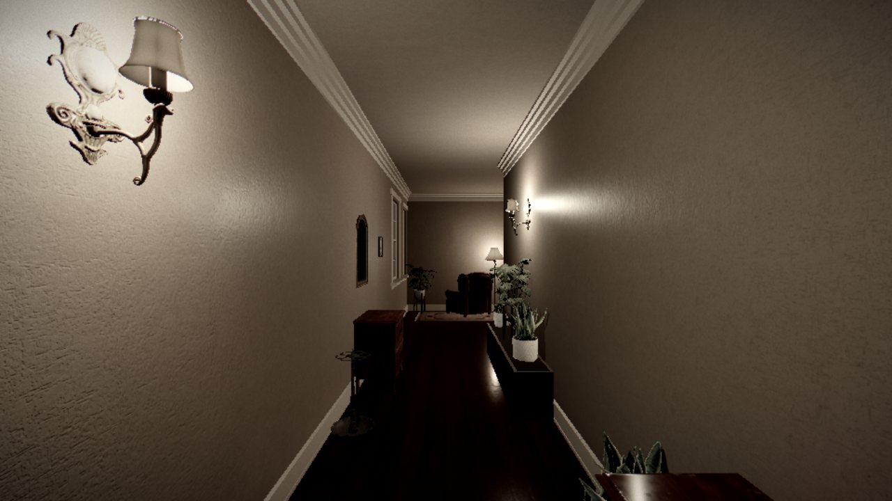
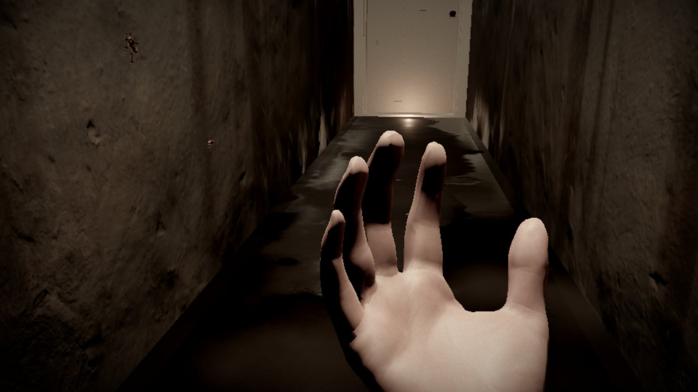
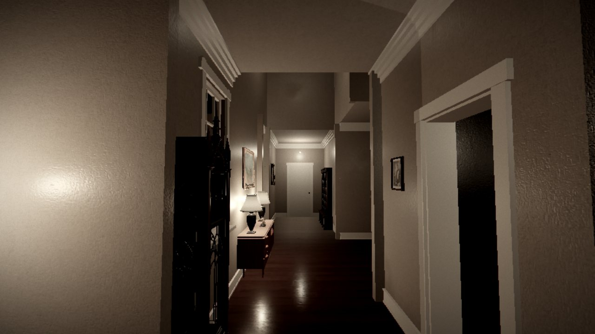
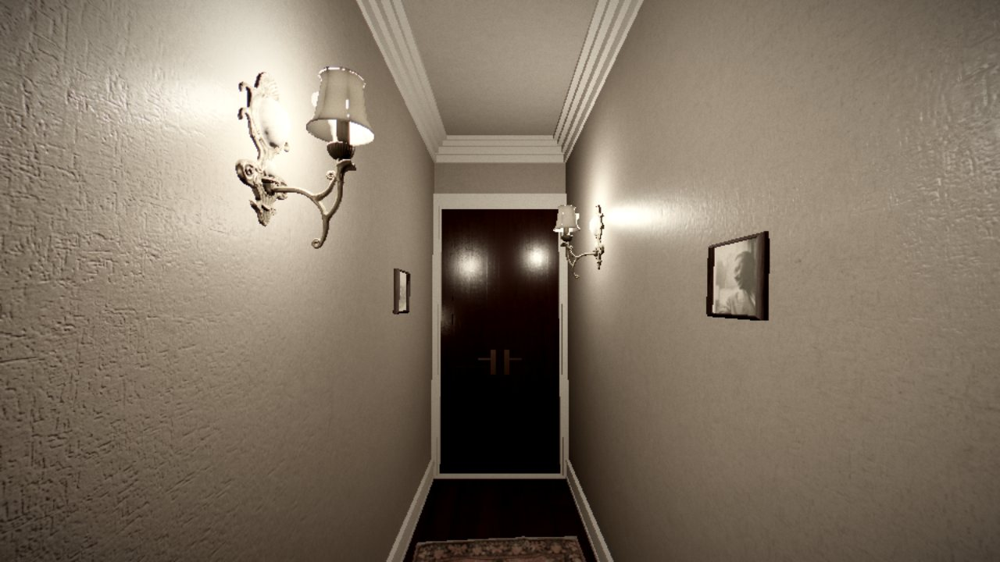
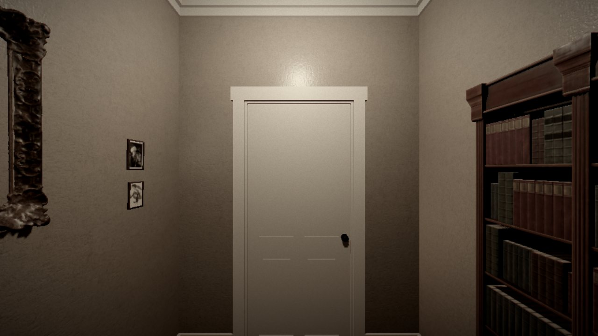

<div align="center">

# LOOP

First-person horror game for the browser.

**English** · [Tiếng Việt](README.vi.md) · [日本語](README.ja.md)

[](https://github.com/nhhthong/loop/actions/workflows/ci.yml)
[](LICENSE)

### [▶ Play](https://nhhthong.github.io/loop/)



</div>

## About

You wake up in a wet basement corridor. A door leads into an empty house: dim lamps, a creaking ceiling fan,
doors that will not open. No dialogue, no jump scares, only light, sound and space.

| | |
|:---:|:---:|
|  |  |
|  |  |

## Features

- Photoreal WebGL: PBR, wet surfaces, reflection probes, ambient occlusion, bloom.
- Wake-up intro with a photoscanned hand rigged at runtime.
- Rapier physics movement, positional audio, crawling cockroaches.
- Graphics presets: Low / Medium / High.
- Desktop and mobile (touch controls, landscape).

## Controls

| | Desktop | Mobile |
|---|---|---|
| Move | WASD | Left stick |
| Look | Mouse | Drag |
| Interact | E | E button |
| Run / Crouch | Shift / C | — |
| Pause | Esc | Pause button |

## Run locally

```bash
npm install
npm run dev     # http://localhost:5173  (?q=low|medium|high)
npm run build
```

Stack: TypeScript, three.js, Rapier, Vite, postprocessing, N8AO.

## License

Code: [MIT](LICENSE). Assets in `public/` keep their own licences (Sketchfab CC BY / CC0, Poly Haven CC0, Freesound CC0),
listed in each `manifest.json` and on the in-game Credits screen.
