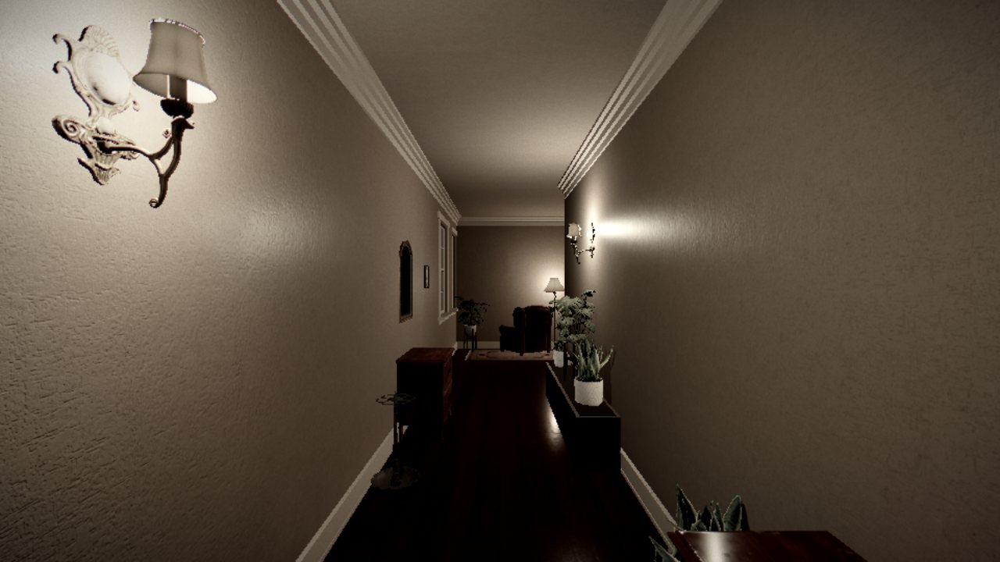
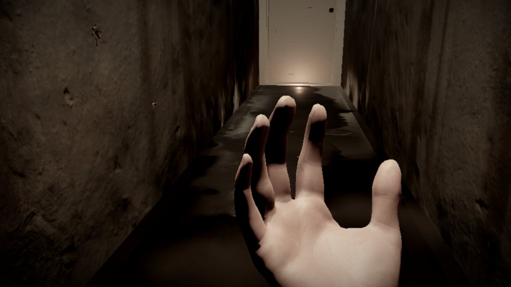
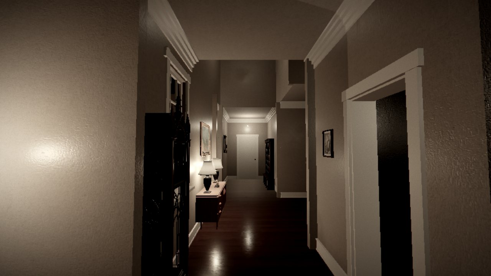
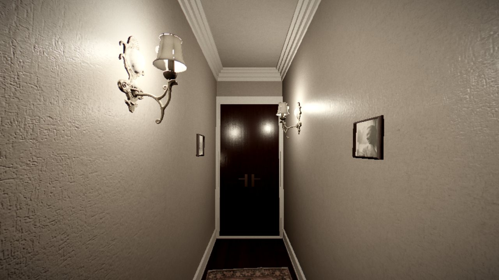
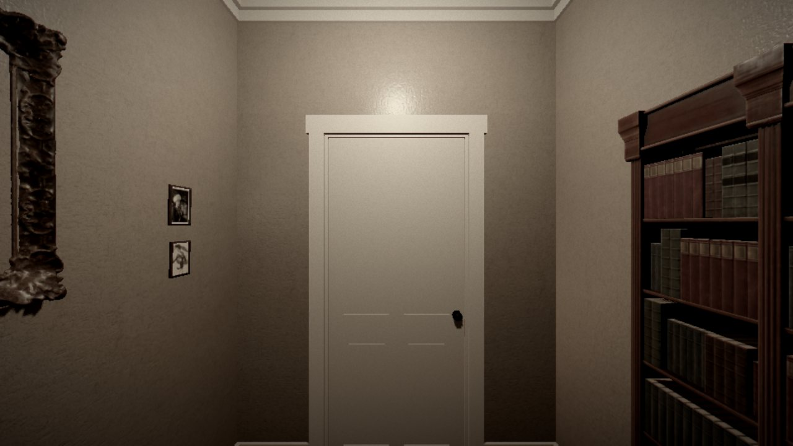

<div align="center">

# LOOP

Game kinh dị góc nhìn thứ nhất chạy trên trình duyệt.

[English](README.md) · **Tiếng Việt** · [日本語](README.ja.md)

[](https://github.com/nhhthong/loop/actions/workflows/ci.yml)
[](LICENSE)

### [▶ Chơi ngay](https://nhhthong.github.io/loop/)



</div>

## Giới thiệu

Bạn tỉnh dậy trong hành lang tầng hầm ẩm ướt. Một cánh cửa dẫn vào căn nhà bỏ trống: đèn mờ, quạt trần cọt kẹt,
những cánh cửa không mở được. Không thoại, không hù dọa, chỉ có ánh sáng, âm thanh và không gian.

| | |
|:---:|:---:|
|  |  |
|  |  |

## Tính năng

- Đồ hoạ WebGL chân thực: PBR, bề mặt ẩm ướt, phản chiếu, ambient occlusion, bloom.
- Intro tỉnh dậy với bàn tay scan 3D, dựng xương lúc chạy.
- Di chuyển bằng vật lý Rapier, âm thanh 3D, gián bò trên tường.
- Ba mức đồ hoạ: Low / Medium / High.
- Hỗ trợ máy tính và điện thoại (điều khiển cảm ứng, màn ngang).

## Điều khiển

| | Máy tính | Điện thoại |
|---|---|---|
| Di chuyển | WASD | Joystick trái |
| Nhìn | Chuột | Vuốt |
| Tương tác | E | Nút E |
| Chạy / Cúi | Shift / C | — |
| Tạm dừng | Esc | Nút pause |

## Chạy trên máy

```bash
npm install
npm run dev     # http://localhost:5173  (?q=low|medium|high)
npm run build
```

Công nghệ: TypeScript, three.js, Rapier, Vite, postprocessing, N8AO.

## Giấy phép

Mã nguồn: [MIT](LICENSE). Tài nguyên trong `public/` giữ giấy phép gốc (Sketchfab CC BY / CC0, Poly Haven CC0, Freesound CC0),
ghi trong từng `manifest.json` và màn hình Credits trong game.
